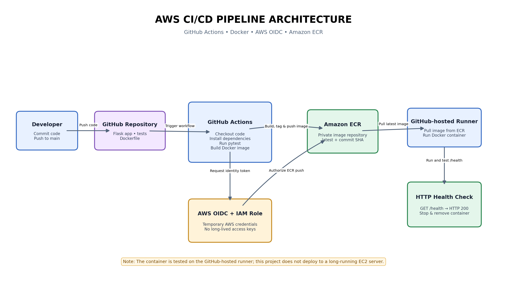

# Automated AWS CI/CD Pipeline with GitHub Actions, Docker and Amazon ECR

## Project Overview

This project demonstrates an automated Continuous Integration and Continuous Deployment (CI/CD) pipeline built with GitHub Actions, Docker and AWS.

The pipeline automatically tests a Flask application, builds a Docker image, authenticates securely with AWS using OpenID Connect (OIDC), and pushes the image to Amazon Elastic Container Registry (ECR).

After publishing the image, the pipeline pulls it back into a GitHub-hosted runner, starts a Docker container and performs an HTTP health check to verify that the application is running correctly.

The goal is to demonstrate how software delivery can be automated while following practical DevOps and cloud security practices.

## Architecture Diagram

The architecture diagram illustrates how code moves from the developer's repository through GitHub Actions and AWS ECR, including the final container health check.



## Project Workflow

The pipeline follows these steps:

1. **Code Management:** The developer pushes application changes to the GitHub repository.
2. **Workflow Trigger:** GitHub Actions automatically starts the pipeline when code is pushed to the `main` branch or a pull request targets `main`.
3. **Repository Checkout:** GitHub Actions checks out the application source code.
4. **Dependency Installation:** Python dependencies are installed.
5. **Automated Testing:** Pytest runs automated tests against the Flask application.
6. **Docker Build:** A Docker image is built from the application source code.
7. **AWS Authentication:** GitHub Actions uses OIDC to obtain temporary AWS credentials through an IAM role.
8. **Amazon ECR Login:** The workflow authenticates with Amazon ECR.
9. **Image Publishing:** The Docker image is tagged with the Git commit SHA and `latest`, then pushed to ECR.
10. **Container Validation:** The pipeline pulls the published image, starts a Docker container and checks the `/health` endpoint.
11. **Cleanup:** The test container is stopped and removed after validation.

## Technology Stack

| Technology | Purpose |
|---|---|
| Python | Application development |
| Flask | Web application framework |
| Pytest | Automated testing |
| Docker | Application containerization |
| Git & GitHub | Version control and source management |
| GitHub Actions | CI/CD automation |
| AWS IAM | Access control and permissions |
| AWS OIDC | Secure GitHub-to-AWS authentication |
| Amazon ECR | Docker image storage |

## Application Endpoints

The Flask application exposes two endpoints:

| Endpoint | Description |
|---|---|
| `/` | Returns the application welcome message and running status |
| `/health` | Returns the application's health status |

Example health-check response:

```json
{
  "status": "healthy"
}
```

The pipeline uses the `/health` endpoint to verify that the Docker container is responding successfully.

## CI/CD Pipeline Features

- Automated testing on code changes.
- Docker image creation.
- Secure AWS authentication using OIDC.
- Temporary AWS credentials instead of long-lived access keys.
- Automated Docker image publishing to Amazon ECR.
- Image tagging using the Git commit SHA and `latest`.
- Automated container startup and HTTP health validation.
- Automatic cleanup of the test container.

## AWS Configuration

The project uses the following AWS resources:

| Resource | Configuration |
|---|---|
| AWS Region | `us-east-1` |
| ECR Repository | `aws-cicd-pipeline` |
| IAM Role | `GitHubActionsECRRole` |
| OIDC Provider | `token.actions.githubusercontent.com` |
| ECR Image Registry | `695746118696.dkr.ecr.us-east-1.amazonaws.com` |

### Security Implementation

GitHub Actions authenticates with AWS through an IAM OIDC identity provider.

The IAM role trust policy restricts access to the intended GitHub repository and `main` branch.

The attached ECR permissions allow the workflow to authenticate and push Docker images to the designated repository.

GitHub repository configuration uses:

- `AWS_ROLE_ARN` as a repository secret.
- `AWS_REGION` as a repository variable.

No permanent AWS access keys are stored in the GitHub repository.

## Running the Application Locally

### 1. Clone the repository

```bash
git clone https://github.com/MyAmadi01/aws-cicd-pipeline.git
cd aws-cicd-pipeline
```

### 2. Create and activate a virtual environment

```bash
python -m venv .venv
source .venv/bin/activate
```

### 3. Install dependencies

```bash
pip install -r requirements.txt
```

### 4. Run automated tests

```bash
python -m pytest -v
```

### 5. Build the Docker image

```bash
docker build -t aws-cicd-pipeline .
```

### 6. Run the container

```bash
docker run -d --name aws-cicd-app -p 5000:5000 aws-cicd-pipeline
```

### 7. Test the application

Open:

- Application: `http://localhost:5000`
- Health check: `http://localhost:5000/health`

Or run:

```bash
curl http://localhost:5000/health
```

### 8. Stop and remove the container

```bash
docker stop aws-cicd-app
docker rm aws-cicd-app
```

## Project Evidence

Screenshots demonstrating the successful implementation are available in the `screenshots/` directory.

| Screenshot | Evidence |
|---|---|
| `01-github-actions-success.png` | Successful GitHub Actions workflow |
| `02-ecr-images.png` | Docker images published to Amazon ECR |
| `03-ecr-repository.png` | Amazon ECR repository configuration |
| `04-iam-oidc-role.png` | IAM OIDC role configuration |
| `05-ecr-container-health-check.png` | Successful container health check |

The architecture diagram is available in the `diagrams/` directory.

## Current Project Status

**Completed:**

- Flask application development.
- Automated application testing with Pytest.
- Docker containerization.
- GitHub Actions CI/CD workflow.
- AWS OIDC authentication.
- IAM role and ECR permissions configuration.
- Automated Docker image publishing to Amazon ECR.
- Container pull, startup and health validation.
- Project documentation and architecture diagram.

**Future Improvements:**

- Deploy the application to a cloud-hosted environment.
- Implement Infrastructure as Code using Terraform.
- Add application monitoring and centralized logging.
- Implement deployment strategies such as blue-green deployment.
- Add deployment notifications and failure alerts.

**Deployment clarification:** The current pipeline validates the published Docker image by running it inside a GitHub-hosted runner. It does not yet deploy a continuously running application to an EC2 instance or another production hosting environment.

## What This Project Demonstrates

This project demonstrates practical experience with:

- CI/CD pipeline development.
- Linux and command-line workflows.
- Python application testing.
- Docker image creation and management.
- GitHub Actions automation.
- AWS IAM and access management.
- OIDC-based cloud authentication.
- Amazon ECR image management.
- Container validation and troubleshooting.

## Repository

**GitHub:** https://github.com/MyAmadi01/aws-cicd-pipeline

**Author:** MyAmadi01

**Project:** Automated AWS CI/CD Pipeline

